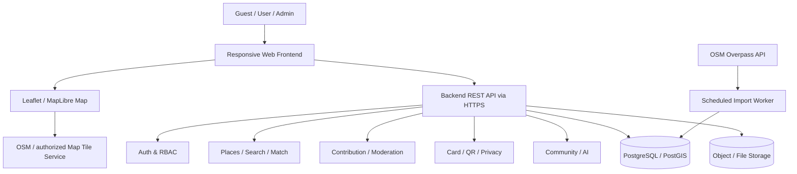

# Product Requirements Document (PRD) — AksesIn

> **Produk:** AksesIn — Aplikasi Web Peta Aksesibilitas Fasilitas Publik bagi Penyandang Disabilitas  
> **Versi dokumen:** 1.0 (draft implementasi)  
> **Tanggal:** 9 November 2026  
> **Sumber utama:** *Proposal PPL Kelompok 1 — qAksesIn/AksesIn*, Telkom University Kampus Jakarta, 2026  
> **Metode:** Agile Scrum | **Cakupan awal:** Jakarta | **Platform:** Responsive Web  
> **Status:** Draft untuk validasi Product Lead dan tim pengembang

## 1. Ringkasan eksekutif

AksesIn adalah aplikasi web untuk menemukan fasilitas publik beserta informasi aksesibilitas yang relevan bagi penyandang disabilitas, pendamping, keluarga, dan masyarakat. Aplikasi menggabungkan data awal tempat dari OpenStreetMap (OSM) melalui Overpass API dengan kontribusi pengguna berbukti foto dan moderasi admin. Pengguna dapat menjelajahi peta, mencari/filter tempat, membaca detail fasilitas, dan mengirim perbaikan informasi. Produk juga direncanakan mendukung personalisasi, kartu aksesibilitas digital, komunitas, dan obrolan AI.

**Prinsip produk:** informasi harus mudah ditemukan, mudah dipahami, dapat ditelusuri asal/kemutakhirannya, dan tidak mengklaim suatu fasilitas tersedia tanpa dukungan data yang memadai.

### 1.1 Masalah

- Informasi fasilitas seperti ramp, akses kursi roda, lift, toilet disabilitas, guiding block, dan parkir khusus tidak selalu tersedia pada aplikasi peta umum.
- Data yang tersedia sering tidak lengkap atau tidak terverifikasi.
- Pengguna membutuhkan informasi sebelum datang ke lokasi, bukan sesudahnya.
- Informasi komunitas memerlukan moderasi agar perubahan data tempat tidak langsung tampil tanpa pemeriksaan.

### 1.2 Tujuan produk

1. Memungkinkan pengguna menemukan tempat dan mengetahui kebutuhan aksesibilitasnya sebelum berkunjung.
2. Menampilkan peta serta detail ketersediaan fitur aksesibilitas secara transparan.
3. Menyediakan alur kontribusi, foto bukti, peninjauan admin, dan riwayat perubahan.
4. Memanfaatkan data terbuka OSM untuk menghindari kondisi peta kosong pada awal peluncuran.
5. Mendukung akses informasi yang inklusif, selaras dengan SDG 10.

### 1.3 Non-goals / batasan rilis awal

- Tidak menjamin sertifikasi resmi suatu tempat sebagai sepenuhnya aksesibel.
- Tidak menjamin semua data OSM akurat atau terbaru.
- Tidak membangun navigasi rute bebas hambatan secara otomatis kecuali disepakati melalui PBI tambahan.
- Digital Accessibility Card **bukan** kartu identitas pemerintah, bukti diagnosis, atau dokumen resmi tanpa kerja sama/otorisasi yang sah.
- AI Chat tidak boleh dijadikan satu-satunya sumber untuk memastikan keamanan/aksesibilitas tempat.

## 2. Audiens, aktor, dan hak akses

| Aktor | Kebutuhan utama | Akses |
|---|---|---|
| Pengunjung (guest) | Melihat peta, mencari/filter, membaca detail tempat dan informasi publik | Read-only tanpa login |
| Pengguna terdaftar (kontributor) | Semua akses guest; menyimpan preferensi, kontribusi, foto, laporan, profil, komunitas, pengajuan kartu, AI Chat | Create/read data milik sendiri; edit/hapus terbatas pada data milik sendiri yang memenuhi aturan status |
| Admin | Menjaga integritas data, moderasi kontribusi/laporan, mengelola tempat, sinkronisasi dan kartu digital | Hak khusus berbasis role; seluruh tindakan sensitif tercatat |
| Publik pemindai QR | Memeriksa informasi kartu yang pemiliknya izinkan tampil | Hanya field publik yang diizinkan, tidak membuka dokumen verifikasi |

**Ketentuan:** preferensi dan informasi jenis disabilitas bersifat opsional dan sensitif; tidak boleh menjadi syarat untuk melihat peta atau membuat kontribusi umum. Pengunjung tidak diharuskan mengungkap kondisi disabilitas.

## 3. Cakupan, tahapan, dan prioritas

Proposal memuat **28 PBI** (14 induk dan 14 turunan) untuk **dua sprint, masing-masing 4 minggu**. Seluruh PBI dipertahankan pada lampiran backlog. Agar pengembangan realistis, rekomendasi urutan rilis berikut **merupakan usulan PRD**, bukan perubahan otomatis terhadap prioritas di proposal.

| Tahap | Sasaran | Fitur |
|---|---|---|
| MVP inti | Alur end-to-end mencari tempat dan memperbaiki data | Auth dasar, peta, impor OSM, pencarian/filter, detail tempat, kontribusi dan foto, moderasi admin, penentuan status |
| Penguatan | Kepercayaan & kenyamanan | Preferensi dan match, confidence & riwayat verifikasi, notifikasi, lokasi tersimpan, profil/riwayat, laporan data keliru |
| Ekstensi | Ekosistem | Digital Accessibility Card + QR + privasi, Community Hub, moderasi konten, AI Chat dan riwayat percakapan |

**Catatan konsistensi proposal:** BAB III memuat 16 kebutuhan fungsional inti; BAB IV dan V memperluas cakupan ke kartu digital, komunitas, preferensi, dan AI Chat. Dokumen ini mencakup keseluruhan cakupan, tetapi penerapan MVP versus ekstensi perlu disetujui tim.

## 4. Perjalanan pengguna utama

### 4.1 Pencarian tempat (tanpa login)

1. Pengunjung membuka beranda atau halaman peta.
2. Peta memuat lokasi Jakarta dari database aplikasi, menampilkan marker status (hijau/kuning/abu-abu) **beserta teks/ikon**.
3. Pengunjung mencari nama, kategori, atau area; dapat menerapkan filter fasilitas dan status.
4. Pengunjung memilih marker/hasil, melihat ringkasan, lalu detail tempat.
5. Detail menunjukkan daftar fasilitas per item, sumber data, foto, status, waktu pembaruan/verifikasi terakhir, dan indikator kepercayaan bila tersedia.
6. Bila ingin berkontribusi, pengunjung diarahkan login/registrasi.

### 4.2 Kontribusi dan moderasi

1. Pengguna login, memilih tempat dan tombol kontribusi.
2. Pengguna mengisi kondisi masing-masing fasilitas: `Ya`, `Tidak`, `Tidak tahu`, dapat mengunggah foto bukti.
3. Sistem validasi dan menyimpan kontribusi `pending`; data publik **belum berubah**.
4. Admin melihat antrean, detail fasilitas, foto, dan riwayat relevan.
5. Admin menyetujui atau menolak (dengan alasan saat ditolak).
6. Bila disetujui, sistem memperbarui data fasilitas, status tempat, dan metadata verifikasi secara atomik; pengguna melihat hasilnya pada riwayat/notifikasi.

### 4.3 Personalisasi

1. Pengguna mendaftar dengan nama/email/password.
2. Pengguna boleh melewati pertanyaan disabilitas dan preferensi.
3. Jika memilih personalisasi, pengguna memilih jenis kebutuhan dan prioritas fasilitas yang relevan.
4. Sistem menampilkan kecocokan tempat berdasarkan preferensi; pengguna tetap dapat melihat semua lokasi.

### 4.4 Pengajuan kartu digital

1. Pengguna login, membaca penjelasan fungsi kartu dan persetujuan pemrosesan data.
2. Pengguna mengajukan kartu dan mengunggah dokumen pendukung yang disyaratkan.
3. Admin meninjau, meminta perbaikan jika didukung workflow, atau memutuskan `verified`/`rejected`.
4. Bila disetujui, aplikasi menampilkan kartu beserta QR yang dapat diverifikasi.
5. Pemilik mengatur field yang boleh tampil ketika QR dipindai; perubahan dan pencabutan status harus diperhitungkan.

### 4.5 Komunitas dan pelaporan

1. Pengguna membaca feed, membuat post, komentar, dan reaksi helpful.
2. Post dapat ditautkan dengan tempat tertentu.
3. Pengguna melaporkan konten bermasalah dengan alasan.
4. Admin memeriksa laporan dan menindaklanjuti (abaikan/hapus konten/beri pembatasan sesuai kebijakan).

## 5. Kebutuhan fungsional dan acceptance criteria

Format: **FR-ID** sebagai referensi implementasi lintas PBI. Kriteria berikut adalah penjabaran operasional dari proposal; detail yang belum ditetapkan ditandai **[Keputusan tim]**.

### FR-01 Autentikasi & onboarding (PBI-01, PBI-02)

- Registrasi nama, email, password; login dan logout aman.
- Validasi input, email unik, password disimpan sebagai hash, error informatif tanpa membocorkan kredensial.
- Pertanyaan disabilitas/preferensi boleh dilewati; registrasi tetap sukses.
- Setelah registrasi, profil serta status kelengkapan onboarding dapat dilihat.
- **AC:** Given data valid, when pengguna mendaftar, then akun tersimpan dan dapat masuk; given pengguna memilih `skip`, then fitur publik dan kontribusi tetap tersedia setelah login.

### FR-02 Preferensi aksesibilitas & personalized match (PBI-03, PBI-04)

- CRUD preferensi fasilitas/prioritas pengguna dan tampilan persentase kecocokan tempat.
- Hasil bisa diurutkan berdasarkan match.
- **AC:** Setelah preferensi diubah, hasil match dihitung ulang; fasilitas `unknown` tidak dihitung otomatis sebagai `tersedia`.
- **[Keputusan tim]:** rumus bobot/skor, penanganan `unknown`, dan arti nilai 0–100%.

### FR-03 Peta, marker dan legenda (PBI-05, PBI-06)

- Menampilkan lokasi pada peta interaktif, zoom/pan, marker status dengan popup nama/kategori/status.
- Legenda status: `Accessible` hijau, `Partially Accessible` kuning, `Unknown` abu-abu.
- **AC:** Klik/tap marker memunculkan ringkasan dan tautan ke detail; status terbaca lewat teks/ikon tanpa bergantung pada warna.
- **[Keputusan tim]:** otorisasi usulan penanda tempat baru yang disebut dalam CRUD PBI-05 (disarankan tetap melalui approval admin).

### FR-04 Pencarian dan filter (PBI-07, PBI-08)

- Cari berdasarkan nama, kategori, area/alamat; filter berdasarkan fasilitas serta status; tampilkan daftar hasil.
- Riwayat pencarian dan filter tersimpan sesuai konteks akun; dukung urut jarak/status bila data lokasi mendukung.
- **AC:** Saat tidak ada hasil, tampil state kosong dan opsi reset filter; kombinasi filter diterapkan secara konsisten ke peta dan list.
- **[Keputusan tim]:** semantik filter multi-fasilitas (AND/OR), retensi riwayat dan permintaan izin lokasi.

### FR-05 Integrasi OSM / Overpass (PBI-09, PBI-10)

- Impor data Jakarta, map atribut OSM ke skema internal, upsert berdasarkan identitas sumber, deduplikasi, histori job, dan status berhasil/gagal.
- Proses impor dijalankan backend; pembukaan peta mengambil data dari DB lokal, bukan query langsung Overpass.
- **AC:** Job gagal tidak menghapus data terakhir yang valid; admin dapat melihat jumlah record diproses, waktu, error, dan status.
- Atribusi OSM/ODbL terlihat sesuai kewajiban penggunaan data; atur sumber dan tanggal sinkronisasi.
- **[Keputusan tim]:** cakupan kategori OSM, frekuensi sinkronisasi, penanganan konflik dengan kontribusi terverifikasi.

### FR-06 Detail tempat & galeri (PBI-11, PBI-12)

- Detail: nama, kategori, alamat, koordinat, status, daftar fasilitas, foto bukti, waktu pembaruan/verifikasi, sumber data.
- Mendukung catatan pengalaman pengguna yang tercantum dalam CRUD PBI-11, jika disetujui sebagai bagian scope.
- **AC:** Data fasilitas yang tidak diketahui ditampilkan `Belum ada informasi`, bukan `Tidak tersedia`; foto hanya dari konten yang layak dipublikasikan.

### FR-07 Kontribusi aksesibilitas & status (PBI-13, PBI-14)

- Pengguna login mengirim pembaruan per fasilitas dan foto; dapat melihat/edit/hapus kontribusi sendiri **sebelum diproses**.
- Status `pending`, `approved`, `rejected` dan alasan penolakan dapat ditampilkan.
- **AC:** Kontribusi pending tidak mengubah informasi publik; kontribusi yang ditolak tidak mengubah data tempat; kontributor menerima status hasil moderasi.
- **[Keputusan tim]:** ukuran/jumlah/format foto, apakah minimal satu foto wajib, waktu moderasi, strategi konflik.

### FR-08 Verifikasi komunitas & confidence (PBI-15, PBI-16)

- Pengguna dapat mengonfirmasi informasi, melihat jumlah verifikasi dan waktu verifikasi terakhir.
- Tampilkan badge confidence (rendah/sedang/tinggi) dan riwayat yang aman dipublikasikan.
- **AC:** Verifikasi ganda pengguna yang sama terhadap item yang sama tidak menambah hitungan tanpa batas; perubahan nilai diverifikasi mengikuti aturan moderasi.
- **[Keputusan tim]:** formula confidence, bobot usia data, dan pengaruh verifikasi vs keputusan admin.

### FR-09 Kartu digital — pengajuan (PBI-17, PBI-18)

- Pengguna dapat membuat, melihat, memperbarui, atau membatalkan pengajuan sesuai statusnya; melampirkan dokumen dengan consent eksplisit.
- Notifikasi perubahan status (pending, butuh perbaikan jika diterapkan, verified, rejected, revoked jika diterapkan).
- **AC:** Hanya pemilik dapat melihat data/dokumen pengajuan; pengguna dapat melihat status serta alasan penolakan yang relevan.
- **[Keputusan tim]:** otoritas penerbitan, kelayakan, jenis berkas, masa berlaku dan dasar pemrosesan dokumen sensitif.

### FR-10 Verifikasi, penerbitan & QR kartu (PBI-19, PBI-20)

- Admin mencari/meninjau permohonan, mencatat keputusan dan riwayat verifikasi.
- Untuk pengajuan yang disetujui, sistem menerbitkan kartu dan QR yang dapat dicek keabsahan statusnya.
- Pengguna mengatur privasi field publik; dokumen pendukung tidak disertakan dalam payload QR.
- **AC:** QR untuk kartu rejected/revoked/expired tidak menampilkan status valid; setiap keputusan admin tercatat dengan aktor dan waktu.
- **[Keputusan tim]:** mekanisme token QR tak mudah ditebak, masa berlaku, verifikasi publik, penghapusan dokumen.

### FR-11 Profil & aktivitas (PBI-21, PBI-22)

- Profil dasar, preferensi, ringkasan kartu, kontribusi dan riwayat aktivitas, lokasi tersimpan.
- **AC:** Pengguna hanya dapat mengubah/menghapus konten miliknya yang diizinkan; admin tidak otomatis memperoleh akses ke semua informasi sensitif tanpa kebutuhan tugas yang sah.

### FR-12 AI Chat & riwayat (PBI-23, PBI-24)

- Sesi percakapan AI, histori, penamaan/penelusuran percakapan berdasarkan kata kunci atau judul.
- **AC:** Percakapan hanya bisa diakses pemilik; keluaran AI dibedakan dari data lokasi terverifikasi dan tidak boleh mengarang ketersediaan fasilitas.
- **[Keputusan tim]:** penyedia/model AI, sumber konteks, mitigasi halusinasi, biaya, retensi, dan persetujuan data pengguna.

### FR-13 Community Hub (PBI-25, PBI-26)

- Feed, post, komentar, helpful reaction, kategori, post terkait tempat, notifikasi balasan.
- **AC:** Post baru muncul sesuai aturan publikasi; edit/hapus hanya oleh pemilik atau admin; feed punya pagination dan empty state.

### FR-14 Update terkait tempat & pelaporan (PBI-27, PBI-28)

- Tautkan post ke tempat, laporkan konten, lacak status laporan, cari post per tempat.
- Admin meninjau konten/laporan dan mencatat tindakan moderasi.
- **AC:** Laporan tersimpan dengan target dan alasan, tidak langsung menghapus konten tanpa aturan moderasi; pengguna tidak dapat memoderasi laporan sendiri.

### FR-15 Operasi admin lintas modul (bersumber BAB III–IV)

- Dashboard admin: master data tempat/kategori; antrean kontribusi; laporan informasi keliru; laporan komunitas; pengajuan kartu; histori impor.
- **AC:** Semua endpoint admin menolak pengguna non-admin; keputusan moderasi memiliki audit trail; data peta terbarui hanya setelah transaksi approval berhasil.

### FR-16 Halaman informasi publik (bersumber BAB III)

- Halaman About, Contact, sumber data, batasan akurasi, ketentuan penggunaan dan kebijakan privasi.
- **AC:** Bisa dibuka guest; kontak pengelola valid setelah disepakati tim.

## 6. Aturan bisnis & status

### 6.1 Status tempat

| Status | Warna | Makna produk |
|---|---|---|
| Accessible | Hijau | Informasi fasilitas yang diperlukan menurut aturan klasifikasi menunjukkan tempat aksesibel |
| Partially Accessible | Kuning | Hanya sebagian kebutuhan/fasilitas terpenuhi menurut aturan klasifikasi |
| Unknown / Belum Terverifikasi | Abu-abu | Data tidak cukup atau belum layak diverifikasi |

**Penting:** Proposal menyebut tiga status, tetapi **belum merinci algoritme deterministik**. Sebelum implementasi wajib diputuskan apakah status bersifat umum atau bergantung preferensi, kriteria wajib, dan cara memperlakukan data `Tidak` serta `Tidak tahu`. Sampai itu diputuskan, jangan hard-code ambang arbitrer.

### 6.2 Data dan moderasi

- Data OSM menyimpan referensi `source_type`, `source_id`, `source_updated_at` jika tersedia.
- Kontribusi pengguna tidak mengubah record publik tanpa persetujuan admin.
- Keputusan approval/rejection dicatat dan dapat diaudit.
- Data tidak diketahui tidak dianggap tidak tersedia.
- Bila impor OSM bertentangan dengan data komunitas yang telah diapprove, tidak boleh diam-diam menimpa keputusan terverifikasi; definisikan precedence dan review conflict.
- Foto/dokumen disimpan terpisah dari metadata dan diberi kontrol akses sesuai sensitivitas.

### 6.3 State workflow yang diusulkan

```text
Contribution: draft -> pending -> approved | rejected
Card: draft -> pending -> verified | rejected | cancelled
                        -> needs_revision (opsional)
Verified Card: verified -> expired | revoked (jika fitur diaktifkan)
Community Report: submitted -> under_review -> resolved | dismissed
OSM Import: queued -> running -> succeeded | failed
```

Status tambahan seperti `draft`, `needs_revision`, `expired`, `revoked`, dan `under_review` adalah **usulan desain** untuk divalidasi, bukan seluruhnya keputusan eksplisit proposal.

## 7. Data model konseptual

ERD proposal mengidentifikasi entitas berikut; ini **bukan skema SQL final**.

| Domain | Entitas |
|---|---|
| Akun & personalisasi | `users`, `disability_profiles`, `disability_types`, `user_disabilities`, `user_accessibility_preferences` |
| Tempat & fasilitas | `places`, `accessibility_features`, `place_accessibility`, `saved_places` |
| Kontribusi & bukti | `accessibility_contributions`, `contribution_items`, `contribution_evidence` |
| Kartu | `digital_cards`, `card_privacy_settings`, `card_evidence`, `card_verifications` |
| Komunitas | `community_posts`, `community_comments`, `community_reactions`, `reports` |
| Operasional yang disarankan | `import_jobs`, `notifications`, `audit_logs`, `ai_conversations`, `ai_messages`, `place_change_history` — **usulan tambahan, verifikasi terhadap ERD final** |

### 7.1 Atribut minimal untuk implementasi (usulan)

- `places`: id, osm_type, osm_id, name, category_id, address, latitude, longitude, public_status, data_source, last_updated_at.
- `place_accessibility`: place_id, feature_id, availability (`yes/no/unknown`), verified_at, confidence metadata.
- `accessibility_contributions`: id, place_id, user_id, status, submitted_at, reviewed_by, reviewed_at, rejection_reason.
- `contribution_items`: contribution_id, feature_id, proposed_availability.
- `contribution_evidence`: contribution_id, file_path, mime_type, moderation_state.
- `card_verifications`: card_id, reviewer_id, decision, reason, created_at.
- `audit_logs`: actor_id, action, target_type, target_id, timestamp, metadata aman.

Gunakan foreign key, indeks pada `places` dan hubungan domain, pembatasan role/ownership, dan transaksi pada approval. Untuk geospasial, pertimbangkan PostgreSQL + PostGIS sesuai usulan proposal.

## 8. Arsitektur & integrasi



**Pilihan teknis dalam proposal (masih usulan, bukan keputusan final):** PHP/Laravel **atau** Node.js backend; HTML/CSS/JavaScript frontend; Leaflet **atau** MapLibre; PostgreSQL+PostGIS **atau** MySQL; web server Nginx/Apache; file storage lokal/cloud; deployment VPS. Rekomendasi praktis: pilih **satu** stack sebelum sprint dimulai, buat migration database dan API contract, lalu hindari penggantian stack saat integrasi.

### 8.1 API contract awal (usulan, bukan endpoint eksisting)

| Method / Path | Tujuan | Akses |
|---|---|---|
| `POST /api/auth/register`, `POST /api/auth/login` | Registrasi/login | Public |
| `GET /api/places?bbox=&q=&category=&features=&status=` | Data peta dan pencarian | Public |
| `GET /api/places/{id}` | Detail tempat | Public |
| `GET /api/places/{id}/evidence` | Foto yang disetujui | Public |
| `GET/PUT /api/me/preferences` | Preferensi pribadi | User |
| `POST /api/places/{id}/contributions` | Kirim laporan aksesibilitas | User |
| `GET /api/me/contributions` | Riwayat kontribusi | User |
| `GET /api/admin/contributions` | Antrean moderasi | Admin |
| `POST /api/admin/contributions/{id}/decision` | Approve/reject | Admin |
| `GET/POST /api/card-applications` | Pengajuan kartu | User |
| `POST /api/admin/card-applications/{id}/decision` | Verifikasi kartu | Admin |
| `GET /api/cards/verify/{token}` | Verifikasi QR sesuai privasi | Public, restricted payload |
| `GET/POST /api/community/posts` | Feed dan post | Guest read; user write |
| `POST /api/reports` | Laporkan konten/informasi | User |
| `POST /api/admin/osm-imports` | Jalankan impor | Admin |

Penamaan dan pemecahan endpoint perlu disesuaikan dengan framework serta desain security final.

## 9. Non-functional requirements (NFR)

| ID | Syarat | Cara uji |
|---|---|---|
| NFR-01 | UI jelas, konsisten, mobile responsive | UAT mobile/desktop pada alur utama |
| NFR-02 | Aksesibilitas web: kontras memadai, alt text, keyboard, label, ikon/teks untuk status | Audit accessibility dan uji keyboard; **target WCAG 2.2 AA diusulkan**, proposal hanya menyebut prinsip WCAG |
| NFR-03 | Autentikasi, otorisasi role dan ownership | Uji akses guest/user/admin serta negative security cases |
| NFR-04 | Peta dan hasil pencarian tampil **≤5 detik** pada koneksi internet normal (target dari proposal) | Pengukuran pada kondisi jaringan uji yang disepakati |
| NFR-05 | Tersedia melalui internet dan meminimalkan gangguan | Monitor uptime/error; target persentase uptime perlu ditentukan |
| NFR-06 | Aplikasi tetap dapat membaca data tersimpan saat Overpass tidak dapat diakses | Simulasi gagal koneksi Overpass |
| NFR-07 | Mampu menangani pertumbuhan data lokasi/pengguna | Uji paginasi, bbox, indeks geospasial dan load test |
| NFR-08 | Kompatibel browser modern Chrome/Firefox/Edge | Cross-browser smoke test |
| NFR-09 | Kontribusi approved saja yang memengaruhi data publik | E2E test moderasi |
| NFR-10 | Backup berkala dan proses restore teruji | Dry-run backup-restore; frekuensi disepakati |
| NFR-11 | Atribusi OSM dan kepatuhan ODbL | Checklist lisensi dan attribution UI |
| NFR-12 | Logging login, kontribusi, keputusan moderasi dan impor | Audit trail integration test |
| NFR-13 | Perlindungan dokumen disabilitas dan privasi QR | Uji akses tanpa izin, token, consent, deletion/retention policy |

## 10. Keamanan, privasi, dan etika

- Terapkan HTTPS, hashing password, validasi backend, rate limits untuk login/upload/pelaporan, dan pemeriksaan otorisasi **di server**.
- Sanitasi konten buatan pengguna, cegah XSS/CSRF/SQL injection sesuai stack; filter tipe file berbasis MIME dan batasi ukuran upload.
- Dokumen kartu digital dan data kondisi disabilitas diperlakukan sebagai data sensitif: minimisasi data, consent, hak akses terbatas, retensi dan penghapusan yang jelas.
- Hindari memasukkan dokumen, nomor identitas, atau informasi medis ke QR publik.
- Jangan menggunakan geolokasi pengguna tanpa izin; sediakan cara manual mencari area.
- Jelaskan bahwa informasi tempat dapat berubah dan pengguna perlu mengecek kondisi terbaru untuk kebutuhan kritis.
- Uji aksesibilitas dengan pengguna nyata bila memungkinkan, tidak hanya otomatis.

## 11. Halaman & navigasi utama

**Publik:** Landing/beranda publik, peta/eksplorasi, hasil pencarian, detail tempat, galeri foto, About, Contact, login, registrasi.  
**Pengguna:** dashboard, onboarding, preferensi, profil, lokasi tersimpan, riwayat kontribusi, formulir kontribusi, kartu digital + privasi QR, Community Hub, AI Chat/riwayat.  
**Admin:** dashboard ringkasan, master tempat/kategori, impor OSM, antrean kontribusi, laporan data/komunitas, pengajuan dan verifikasi kartu, audit log.

Mockup proposal menggambarkan beranda publik, halaman login, registrasi empat langkah, dashboard pengguna, map view, detail mobile, dan forum komunitas. Konsistensi antarmuka harus merujuk ke mockup tersebut, sementara tampilan admin dan AI Chat membutuhkan keputusan UI lanjutan.

## 12. Metrik keberhasilan (usulan KPI, belum target resmi)

- **Coverage:** jumlah tempat terpetakan di Jakarta dan persentase tempat dengan informasi fasilitas yang tidak `unknown`.
- **Quality:** persentase kontribusi diproses; waktu median moderasi; tingkat koreksi/klaim keliru.
- **Discovery:** rasio pencarian yang menghasilkan tempat; waktu dari membuka peta sampai melihat detail lokasi.
- **Engagement:** pengguna aktif, kontributor aktif, kontribusi terverifikasi per minggu.
- **Accessibility:** tingkat keberhasilan task pengguna keyboard/screen reader dan jumlah temuan kritis.
- **Reliability:** latency peta/search, error rate, keberhasilan job OSM, jumlah insiden.

Baseline dan target numerik wajib ditetapkan saat planning; jangan menganggap angka KPI yang belum disepakati sebagai requirement dari proposal.

## 13. Pengujian & Definition of Done

Setiap PBI dianggap selesai bila:

- Acceptance criteria diimplementasikan dan dapat didemokan end-to-end.
- Code direview, migration dijalankan dan diuji, serta kontrak API terdokumentasi.
- Test mencakup happy path, invalid input, role/ownership, loading/empty/error states.
- Pada fitur publik, dilakukan pengujian keyboard, label dan kontras; pada mobile dilakukan responsive QA.
- Foto/berkas melewati validasi akses dan tipe file; tidak mengekspos data sensitif.
- Perubahan yang memengaruhi data publik memiliki audit log dan rollback/error handling.
- Tidak ada bug blocker/critical pada alur utama; hasil sprint review diterima Product Lead.

### Skenario E2E prioritas

1. Guest mencari tempat Jakarta -> melihat marker, filter, detail, status, dan galeri.
2. User registrasi dengan skip onboarding -> login -> membuat kontribusi dengan bukti -> status pending.
3. Admin approve kontribusi -> detail tempat berubah -> notifikasi user tampil.
4. Admin reject kontribusi -> data publik tidak berubah -> alasan terlihat.
5. Overpass down saat refresh -> data yang tersimpan tetap dapat dibaca.
6. Pengguna tanpa role admin mencoba akses endpoint moderasi -> ditolak.
7. QR kartu hanya menunjukkan data sesuai izin dan status kartu.
8. Pengguna melaporkan post -> admin memoderasi -> status laporan terlacak.

## 14. Risiko, dependensi, dan mitigasi

| Risiko / dependensi | Dampak | Mitigasi |
|---|---|---|
| Data OSM tidak lengkap, usang atau duplikat | Kepercayaan dan kualitas pencarian | Tag sumber, tanggal update, dedup dan kontribusi terverifikasi |
| Overpass rate limit/down | Impor gagal | Job background, retry/backoff, cache database, histori job |
| Status Accessible ambigu | Salah interpretasi keputusan kunjungan | Aturan klasifikasi eksplisit + tampilan rincian per fitur |
| Moderasi menumpuk | Data pengguna tidak kunjung diperbarui | Antrean prioritas dan dashboard admin |
| Dokumen kartu disalahgunakan | Risiko privasi serius | Minimalkan pengumpulan, proteksi storage, privacy controls dan aturan retensi |
| AI menjawab dengan data yang tidak ada | Misinformasi | Ground ke data internal, tampilkan sumber/ketidakpastian, fallback |
| Scope 28 PBI selama 8 minggu | Kualitas atau fitur tidak tuntas | Tetapkan MVP, dependensi dan kapasitas sprint; demo incremental |
| Integrasi tim tujuh developer | Konflik schema/API & duplicate work | API contract, migrations, branch policy, CI dan ownership |

## 15. Keputusan terbuka yang harus dikunci

1. Nama brand final: sampul menyebut **qAksesIn** sementara isi memakai **AksesIn**.
2. Stack final backend/frontend/database/map dan deployment.
3. Kategori tempat dan batas administrasi Jakarta yang akan diimpor.
4. Rumus status tempat (`Accessible/Partially Accessible/Unknown`) dan confidence.
5. Formula personalized match serta behavior pada data `unknown`.
6. Apakah kontribusi wajib melampirkan foto? Batas upload, aturan publikasi dan hak banding.
7. Hak CRUD usulan tempat baru dan komentar/catatan pengalaman pengguna.
8. Workflow lengkap kartu, legalitas istilah “terverifikasi”, masa berlaku QR, privasi dan retensi dokumen.
9. Penyedia AI, basis pengetahuan, biaya dan data retention.
10. Strategi notifikasi (in-app/email), retention log, backup cadence dan batas moderasi.
11. Rincian fitur AI/admin di mockup dan prioritas rilis jika waktu terbatas.

## 16. Lampiran A — Product Backlog (sesuai proposal)

Di bawah ini ID, judul, urutan sprint, dan prioritas dipertahankan dari tabel BAB V. PBI turunan terkait langsung dengan PBI induk bernomor ganjil sebelumnya.

| Sprint | ID | PBI | Prioritas |
|---|---|---|---|
| Sprint 1 | PBI-01 (induk) | Registration & Disability Onboarding | Tinggi |
| Sprint 1 | PBI-02 (turunan dari PBI-01 | Registration Notification & Onboarding Status View | Sedang |
| Sprint 1 | PBI-05 (induk) | Accessibility Map | Tinggi |
| Sprint 1 | PBI-06 (turunan dari PBI-05 | Map Legend & Place Status Preview | Rendah |
| Sprint 1 | PBI-09 (induk) | OpenStreetMap / Overpass Place Data Integration | Tinggi |
| Sprint 1 | PBI-10 (turunan dari PBI-09 | Data Import Status & Update Notification View | Rendah |
| Sprint 1 | PBI-13 (induk) | Accessibility Contribution | Tinggi |
| Sprint 1 | PBI-14 (turunan dari PBI-13 | Contribution Status Notification | Sedang |
| Sprint 1 | PBI-17 (induk) | Digital Accessibility Card Application | Sedang |
| Sprint 1 | PBI-18 (turunan dari PBI-17 | Card Application Status Notification | Sedang |
| Sprint 1 | PBI-21 (induk) | User Profile & Activity | Sedang |
| Sprint 1 | PBI-22 (turunan dari PBI-21 | Profile Summary & Activity History View | Rendah |
| Sprint 1 | PBI-25 (induk) | Community Hub | Sedang |
| Sprint 1 | PBI-26 (turunan dari PBI-25 | Community Feed & Notification View | Rendah |
| Sprint 2 | PBI-03 (induk) | Accessibility Preference & Personalized Match | Tinggi |
| Sprint 2 | PBI-04 (turunan dari PBI-03 | Personalized Match Result View | Sedang |
| Sprint 2 | PBI-07 (induk) | Search, Category & Accessibility Filter | Tinggi |
| Sprint 2 | PBI-08 (turunan dari PBI-07 | Search Result List & Search History View | Rendah |
| Sprint 2 | PBI-11 (induk) | Place Detail & Accessibility Information | Tinggi |
| Sprint 2 | PBI-12 (turunan dari PBI-11 | Place Photo Gallery & Last Update View | Rendah |
| Sprint 2 | PBI-15 (induk) | Community Verification & Confidence | Rendah |
| Sprint 2 | PBI-16 (turunan dari PBI-15 | Confidence Badge & Verification History View | Rendah |
| Sprint 2 | PBI-19 (induk) | Digital Card Verification & Issuance Management | Sedang |
| Sprint 2 | PBI-20 (turunan dari PBI-19 | Card Application Search & Review History View | Rendah |
| Sprint 2 | PBI-23 (induk) | AI Chat & Conversation History | Sedang |
| Sprint 2 | PBI-24 (turunan dari PBI-23 | Conversation History Search | Rendah |
| Sprint 2 | PBI-27 (induk) | Place-linked Community Update & Reporting | Sedang |
| Sprint 2 | PBI-28 (turunan dari PBI-27 | Report Status Notification & Place Post Search | Rendah |

## 17. Lampiran B — Pembagian kepemilikan modul

| Penanggung jawab | Modul | PBI |
|---|---|---|
| Muhammad Sheva | Project Manager / Product Lead | PBI-01 Registration & Disability Onboarding; PBI-02 Registration Notification & Onboarding Status View (turunan; PBI-01); PBI-03 Accessibility Preference & Personalized Match; PBI-04 Personalized Match Result View (turunan; PBI-03) |
| Muhammad Shafwan | Developer – Map & Discovery | PBI-05 Accessibility Map; PBI-06 Map Legend & Place Status Preview (turunan; PBI-05); PBI-07 Search, Category & Accessibility Filter; PBI-08 Search Result List & Search History View (turunan; PBI-07) |
| Naufal Adya Pradana | Developer – Place Information & Open Data | PBI-09 OpenStreetMap / Overpass Place Data Integration; PBI-10 Data Import Status & Update Notification View (turunan; PBI-09); PBI-11 Place Detail & Accessibility Information; PBI-12 Place Photo Gallery & Last Update View (turunan; PBI-11) |
| Muhammad Demas Ramadhan | Developer – Contribution & Trust | PBI-13 Accessibility Contribution; PBI-14 Contribution Status Notification (turunan; PBI-13); PBI-15 Community Verification & Confidence; PBI-16 Confidence Badge & Verification History View (turunan; PBI-15) |
| Hafiz Afra Riata | Developer – Digital Accessibility Card | PBI-17 Digital Accessibility Card Application; PBI-18 Card Application Status Notification (turunan; PBI-17); PBI-19 Digital Card Verification & Issuance Management; PBI-20 Card Application Search & Review History View (turunan; PBI-19) |
| Fauziah Wulandari Sudradjat | Developer – AI Chat, Privacy & Profile | PBI-21 User Profile & Activity; PBI-22 Profile Summary & Activity History View (turunan; PBI-21); PBI-23 AI Chat & Conversation History; PBI-24 Conversation History Search (turunan; PBI-23) |
| Arif Rahman Hakim | Developer – Community & Moderation | PBI-25 Community Hub; PBI-26 Community Feed & Notification View (turunan; PBI-25); PBI-27 Place-linked Community Update & Reporting; PBI-28 Report Status Notification & Place Post Search (turunan; PBI-27) |

## 18. Referensi internal

- Proposal PPL Kelompok 1, 2026: BAB I (masalah/tujuan), BAB II (produk/proses bisnis), BAB III (kebutuhan), BAB IV (use case/arsitektur/ERD/mockup), BAB V (Scrum/PBI/tim).
- Semua rekomendasi teknis, skema atribut minimal, endpoint, KPI, dan tahapan MVP pada PRD ini adalah **elaborasi implementasi** yang memerlukan persetujuan tim, kecuali dinyatakan langsung dalam proposal.
